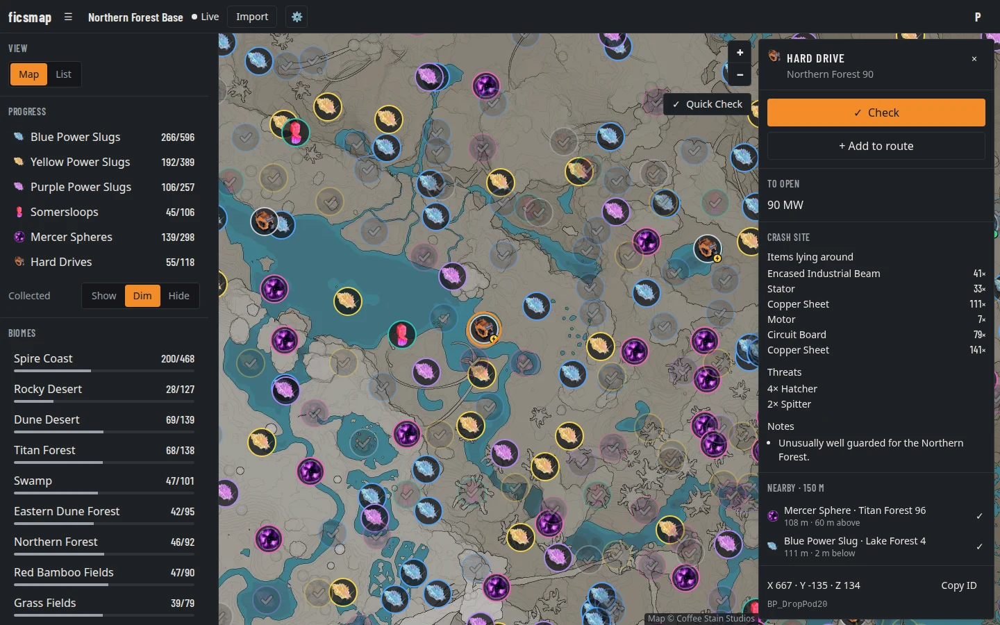
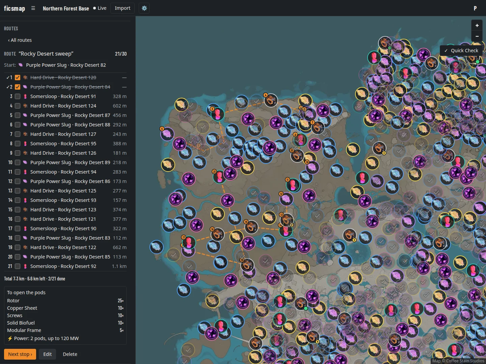

# ficsmap

A shared, live collectibles checklist for Satisfactory: import your save, tick off slugs, sloops, spheres and drop pods with friends, and plan routes.

> ficsmap is an unofficial fan project. It is not affiliated with or endorsed by Coffee Stain Studios.

ficsmap is a self-hosted web app. You run your own instance. The author runs an invite-only instance for friends; there is no public demo.

## Screenshots

**The map.** Every Power Slug, Somersloop, Mercer Sphere and drop pod with the game's icons; collected ones are dimmed. A selected drop pod shows what it takes to open (here 90 MW of power, marked by the bolt on its icon), the items lying around its crash site, the threats and notes.



**The route planner.** A route through the open collectibles of an area: numbered stops on the map and in the list, distances, progress, and everything the route's drop pods need to be opened, summed up.



<sub>Screenshots from a demo world. Map and icons © Coffee Stain Studios.</sub>

## Features

- **Interactive map** with the game's own icons for Blue, Yellow and Purple Power Slugs, Somersloops, Mercer Spheres and drop pods (hard drives).
- **Discord login.** No passwords to manage.
- **Worlds.** Track a world alone or share it with co-op friends. Invite links work once and are valid for 7 days. The owner can revoke all open links and make members admins, who may then import saves, invite, manage upload keys, rename the world and remove members (only the owner can delete the world or change roles).
- **Live sync.** When a member ticks something off, everyone else sees it at once (Server-Sent Events).
- **Save import.** Read a save file to mark everything you have already collected. The save is parsed in your browser.
- **Automatic upload.** A small script (Windows PowerShell, Linux bash or Docker) watches your save folder and uploads every new save to your world, so checks, resource nodes and the factory timeline stay current without opening ficsmap. The owner or an admin configures and downloads it under world settings → "Automatic upload". See [Automatic upload](#automatic-upload).
- **Conflict review.** If the save says an item is still in the world but it is ticked off in ficsmap, it is flagged. Resolve conflicts one by one or in bulk, with undo.
- **Search.** One field in the middle of the top bar (`/` or Ctrl+K) finds collectibles by type, label or actor ID (`BP_WAT139`, also partial), biomes and caves in English and German, crash sites by what lies there or what the pod needs, and machines and vehicles of the wiki. Matches are highlighted on the map; choosing one selects the item, scopes the biome or shows the cave (from a tool page it goes back to the map first), and a machine opens its wiki entry.
- **Sections and map layers.** A world has four sections, tabs under the top bar on wide screens and a menu named after the section shown on narrower ones and phones: Map, Planner, Vehicles and Machines. The planner, the vehicle calculator and the machine wiki are pages of their own under the world's address: `/w/<world>/planner`, `/w/<world>/vehicles` and `/w/<world>/wiki`, with an entry at `/w/<world>/wiki/<entry>` (e.g. `…/wiki/Build_ConstructorMk1_C`). They use the full width of the window in place of the sidebar and the map, can be bookmarked, and keep what you entered when you go back to the map (the Map tab, [←] on narrower screens, or the browser's Back). The cave, height map and resource node layers are switched next to the tabs (in the menu under "Map layers" on narrower screens) while the map is shown.
- **Filters and progress.** Show, dim or hide collected items per type. Limit the view to one biome and see progress per biome. The biomes follow the Satisfactory wiki's biome map, with the game's German names.
- **Height layer.** A switchable colour scale of the terrain height over the map.
- **Item panel.** Drop-pod requirements (item or power) and crash-site information: items lying around, threats and notes.
- **Caves.** A switchable layer with the floor plans of the caves and their entrances, sampled from the game's 3D geometry, and a note in the item panel when an item lies in a cave (with the distance to the nearest entrance).
- **Coordinates and height.** Hovering the map shows the position under the mouse in metres, with the height of the highest surface there, read from the game's terrain and rock geometry.
- **Route planner.** Up to 30 stops, optimise the order, jump to the next stop, and see a combined list of what the route's drop pods need.
- **Vehicle calculator.** Pick a start and a destination on the map (or type the length), choose the vehicle and the fuel, and see what one vehicle does on that route: stacks per minute (items or m³ with an item), the round trip and the one-way trip, and the fuel per round trip, with every fuel compared side by side. Also how many tractors, trucks, drones or freight cars the route needs for a target throughput, and an estimate of the fuel they burn together (Packaged Fuel by default). Capacities, stack sizes, fuel use, speed limits and stop times come from the game files; the speeds are upper limits, so enter the average you see on your route (for trains there is no default).
- **Production planner.** Enter the items you need per minute and get the whole production chain down to miners, water and oil extractors and resource wells: per step the building, the recipe (alternates selectable), the number of buildings and the rates in and out, plus totals of raw resources, buildings, power and surplus. By-products are used for other steps. Miner level, node purity and clock speed (per step, up to 250 % with Power Shards) are adjustable. Recipes, buildings and rates come from the game's own data; values are for the default game mode.
- **List view** as an alternative to the map.
- **Machine and vehicle wiki.** Stats of every production building, extractor, generator, other powered machine and vehicle (power, clock speed, extraction rates, fuels, inventories, build cost, unlocks, recipes), with the game's own description and a link to the Satisfactory wiki. Read from the game's data files.
- **Mobile layout** with a bottom sheet.
- **English and German** user interface, picked from the browser language.

## How it works and privacy

- You sign in with Discord. ficsmap reads your Discord ID, name and avatar. The Discord access token is used once and never stored.
- Accounts are invite-only. A new account is created only for a Discord ID listed in `OWNER_DISCORD_IDS` or for someone who opens a valid invite link.
- **With the normal import your save file never leaves your browser.** It is parsed locally in a Web Worker. Only the list of collected item names (for example `BP_Crystal_mk29`) is sent to the server, together with the file name and the session name, save time and game build from the save header, and for resource nodes: the resource or purity the save sets per node (randomised worlds), the node randomisation settings, and which extractor stands on which node (building type, node name, clock speed, number of Power Shards).
- The **automatic upload** is the exception you opt into: its script sends the whole save file to your ficsmap server, which parses it there (the same extraction as in the browser) and keeps only what an import keeps. The save itself is not stored.
- Ticks, routes and members are stored in a SQLite database on the server you run.

## Automatic upload

The owner or an admin of a world can let a script upload new saves automatically:

1. World settings → **Automatic upload** → create an **upload key** (a name such as "Gaming PC"; "accept saves of any session" only if the world's saves come from more than one session). The key is shown once.
2. Pick the platform, check the save folder (presets for Windows, Steam on Linux (Proton, Flatpak), the Steam Deck and dedicated servers), the session name, how often to check, the upload interval and whether to upload only the newest or every new save, then **Download**.
3. Run it as shown under the button:
   - **Windows:** `powershell -ExecutionPolicy Bypass -File ficsmap-watch.ps1`; the page also shows how to start it at every sign-in with the Task Scheduler. Log: `%LOCALAPPDATA%\ficsmap`.
   - **Linux:** `chmod +x ficsmap-watch.sh && ./ficsmap-watch.sh` (needs bash, curl and sha256sum; with `inotify-tools` it notices new saves at once). `--once` uploads once and exits, for cron.
     To run it only while the game runs, put this into Satisfactory's Steam launch options (Properties → General); it starts the watcher with the game, logs to `~/ficsmap/watch.log` and stops it a minute after the game exits:
     `bash -c 'env -i HOME="$HOME" PATH=/usr/local/bin:/usr/bin:/bin "$HOME/ficsmap/ficsmap-watch.sh" >>"$HOME/ficsmap/watch.log" 2>&1 & w=$!; "$@"; s=$?; sleep 60; kill $w; exit $s' _ %command%`
   - **Docker:** unzip `ficsmap-watch.zip`, then `docker compose up -d --build` in the folder. The image is built locally from the included Dockerfile; the save folder is mounted read-only.

A save newer than the world's last import is imported (checks, resource nodes) and added to the factory timeline; an older one is only added to the timeline; one the world already has is skipped. Saves of another session are refused unless the key accepts any session. On the first start the script uploads only the newest save that is already there; older ones can be added with "Add older saves".

**Upload interval.** The script uploads at most one save per interval (default 30 minutes, 0 for no limit). A save that comes in sooner waits; when the interval is up, only the newest waiting save is uploaded and the ones in between are skipped (in "every new save" mode the log names them). Saves the world already has and failed uploads do not count. The time of the last upload is kept in the state file, so a restart keeps the limit.

**Older saves are thinned out.** The factory timeline keeps every save of the last 2 days, up to 30 days back the newest per hour, up to a year the newest per day, after that the newest per week (counted back from the world's newest save, in UTC). The newest save and the one of the last import always stay.

**The downloaded file contains the key.** Keep it private. Anyone with it can upload saves to that world (nothing else). Revoke a key in the same place when you no longer need it or the file got out. Behind nginx, raise `client_max_body_size` (see [Reverse proxy](#reverse-proxy)), or uploads fail with 413.

## Self-hosting

You need Docker with Compose, a domain with TLS behind a reverse proxy, a Discord application, and a map dataset (see [Dataset](#dataset)).

### Docker Compose

Images are published to `ghcr.io/n1ck145/ficsmap` with the tags `<version>` (for example `0.1.0`), `<major>.<minor>` (for example `0.1`) and `latest`. The images contain no game data.

Create a directory with this `docker-compose.yml`:

```yaml
services:
  ficsmap:
    image: ghcr.io/n1ck145/ficsmap:${FICSMAP_VERSION:-latest}
    env_file: .env
    volumes:
      - ./state:/data
      - ./dataset:/app/data:ro
    ports:
      - "${FICSMAP_PORT:-3000}:3000"
    restart: unless-stopped
```

The directory then looks like this:

```
ficsmap/
  docker-compose.yml
  .env
  state/            app.db, backups/, ficsmap-version.json (written by the app)
  dataset/
    1.2.5.0/        collectibles.min.json, map.json, biomes.geojson, crash-sites.json, tiles/, icons/, caves.geojson, height/
```

`state/` must be writable by the container user (uid 1000):

```sh
mkdir -p state dataset
sudo chown 1000:1000 state
docker compose up -d
```

Include `state/` in your host backup.

### Configuration (.env)

Copy [`.env.example`](.env.example) to `.env`, fill it in and run `chmod 600 .env`. Never commit it.

| Variable | Meaning |
|---|---|
| `PUBLIC_URL` | The URL users open, for example `https://ficsmap.example.com`. Used for the Discord redirect, invite links and the origin check. |
| `DISCORD_CLIENT_ID`, `DISCORD_CLIENT_SECRET` | From your Discord application. |
| `OWNER_DISCORD_IDS` | Comma-separated Discord user IDs that may sign in without an invite. Owners can also confirm a rollback in the browser. |
| `SESSION_SECRET`, `INVITE_JWT_SECRET` | Two different random secrets, at least 32 characters each. Generate with `openssl rand -base64 48`. |
| `TRUST_PROXY` | IP address of your reverse proxy, whose `X-Forwarded-*` headers are trusted. Empty without a proxy. |
| `COOKIE_SECURE` | `true` for HTTPS. Set to `false` only for plain-HTTP testing. |
| `LOG_LEVEL` | `fatal`, `error`, `warn`, `info`, `debug` or `trace`. |
| `FICSMAP_PORT` | Host port for Compose (default `3000`). Not read by the app. |
| `FICSMAP_VERSION` | Optional. Image tag to run (default `latest`). Pin it to control upgrades and to roll back. |

To find your Discord user ID: Discord settings, Advanced, turn on Developer Mode, then right-click your name and choose Copy User ID.

### Discord application

1. Create an application in the [Discord Developer Portal](https://discord.com/developers/applications).
2. Under OAuth2, add the redirect URI `<PUBLIC_URL>/auth/discord/callback`, for example `https://ficsmap.example.com/auth/discord/callback`.
3. Copy the client ID and client secret into `.env`.

ficsmap requests the `identify` scope. No bot is needed.

### Reverse proxy

Put ficsmap behind a reverse proxy that terminates TLS. Live sync uses Server-Sent Events, which are long-lived responses. The proxy must not buffer them and must allow long reads.

nginx:

```nginx
location / {
    proxy_pass http://127.0.0.1:3000;
    proxy_set_header Host $host;
    proxy_set_header X-Forwarded-For $proxy_add_x_forwarded_for;
    proxy_set_header X-Forwarded-Proto $scheme;
    proxy_buffering off;
    proxy_read_timeout 3600s;
    client_max_body_size 64m;   # saves from the automatic upload
}
```

Caddy:

```
ficsmap.example.com {
    reverse_proxy 127.0.0.1:3000 {
        flush_interval -1
    }
}
```

Set `TRUST_PROXY` to the IP address the proxy connects from.

### Dataset

The map dataset is **not** part of this repository or the Docker image, because it consists of Coffee Stain Studios' game assets. You build it yourself from your own game installation and mount it into the container (`./dataset:/app/data:ro`). The app uses the newest version directory it finds there (`DATASET_VERSION=latest`, the default), so a new dataset can be copied next to the old one; set `DATASET_VERSION` in `.env` to a folder name (e.g. `1.2.4.1`) to pin one.

A dataset directory `<game-version>/` contains `collectibles.min.json`, `map.json`, `biomes.geojson`, `crash-sites.json`, `tiles/` and `icons/`, optionally `caves.geojson` (cave outlines and entrances; a dataset built without caves offers no cave layer) `height/` (height map tiles; without it the coordinates show no height), `resource-nodes.json` (resource nodes, geysers and resource wells; without it there is no resource node layer), `recipes.json` (recipes, buildings and extractors for the production planner; without it the planner says the data is missing), `machines.json` (the machine and vehicle wiki; without it the wiki says so), `icons/items/` (the game's pictures of items, machines, vehicles and buildables; without it the wiki shows no pictures), `buildings.json` (footprints, names, categories and pictures of every buildable and vehicle for the factory map) and `transport.json` (vehicle and item data for the vehicle calculator; without it the calculator says the dataset has no vehicle data).

To build one:

1. Extract the game data with [SatisfactoryTools/AssetsExtractor](https://github.com/SatisfactoryTools/AssetsExtractor) `world-extractor-net`, with the patch `data-src/extractor/world-extractor-extras.patch` applied, against your own Satisfactory install. The exact steps are in [`data-src/extractor/README.md`](data-src/extractor/README.md).
2. In a checkout of this repository, run:

   ```sh
   npm ci
   npm run dataset -- --extractor <extractor-output-dir> --data-src <dir> --build <changelist> --out data/1.2.5.0
   ```

   `--data-src` points to a folder with `biomes/biomes.editor.geojson`, `biomes/calibration.json` and `crash-sites/crash-sites.json`. If the extractor output contains `caves.json` and `cave-geometry/` (or you pass `--caves <file> --cave-geometry <dir>`), the build samples the caves, writes `caves.geojson` and marks items that lie in a cave. If it contains `heightmap/` (or you pass `--heightmap <dir>`), the build writes the height map tiles to `height/`, and the cave sampling uses its `landscape.f32` to also mark items deep underground in a cave volume. If it contains `default-world.json` (the extractor's `--out` file, or `--default-world <file>`), the build writes `resource-nodes.json`. If it contains `map-areas/` (or you pass `--map-areas <dir>`), the biomes come from the game's map areas and the editor polygons in `--data-src` are not used. If the extractor output contains `transport.json` (patch flag `--transport-out`, or pass `--transport <file>`) and a copy of the game's `CommunityResources/Docs` folder in `docs/` (or you pass `--docs <install>/CommunityResources/Docs`), the build writes `transport.json` for the vehicle calculator. With the game's Docs (`--docs <install>/CommunityResources/Docs` or a copy in `docs/` of the extractor output) the build also writes `recipes.json` for the production planner and `machines.json` for the machine and vehicle wiki (`npm run recipes` and `npm run machines -- --docs <dir> --out data/<version>` build them on their own). If the extractor output contains `icons/` (patch flag `--icons-out`, or pass `--icons <dir>`), the build copies the pictures of every item, resource, equipment and vehicle and of the buildings that are wiki entries to `icons/items/` (about 240 pictures at 64 and 256 px, 4 MB), with `buildings-raw.json` those of every building class as well (747 pictures, 9.6 MB); it needs the Docs for that too. If it contains `buildings-raw.json` (patch flag `--buildings-out`, or pass `--buildings-raw <file>`) and the Docs, the build writes `buildings.json` for the factory map. By default the build makes every part of the dataset and stops with a list of what is missing if an input is not there; `--only <parts>` (comma-separated or repeated) builds just those parts into an existing dataset folder: `collectibles`, `crash-sites`, `biomes`, `caves`, `heights`, `map`, `nodes`, `transport`, `recipes`, `machines`, `icons`, `buildings` (e.g. `--only recipes,machines` after a game patch that changed recipes).
3. Copy `data/1.2.5.0/` into the `dataset/` directory next to your `docker-compose.yml`.

**Current limitation:** the crash-site data are maintainer data and are not published. With the extractor output (including `map-areas/`) you get the tiles, icons, collectible positions and biomes, but the crash-site layer needs a source of your own in the format above. `--data-src` still has to provide the biome editor files, even though they are unused when `map-areas/` exists.

### Updates

Pin `FICSMAP_VERSION` in `.env` and change it to upgrade:

```sh
docker compose pull
docker compose up -d
```

Automatic updates are optional. For example, [Watchtower](https://containrrr.dev/watchtower/) can watch the container and pull new images. If you run Watchtower with `--label-enable`, add this label to the service:

```yaml
    labels:
      - com.centurylinklabs.watchtower.enable=true
```

### Upgrades and rollbacks

ficsmap stores the version of its last start in `state/ficsmap-version.json`.

**Upgrade.** When a newer version starts, it first backs up the database to `state/backups/pre-v<new>-from-v<old>-<timestamp>.db`, then migrates the database and starts.

**Rollback.** Set `FICSMAP_VERSION=<older version>` in `.env` and run `docker compose up -d`. The older version sees that the stored version is newer. It does not touch the database and starts in maintenance mode: every page shows a maintenance notice. The notice explains that a rollback restores the backup taken before upgrading past this version, and that all changes since then are lost.

Confirm the rollback in one of two ways:

- **Browser:** an owner (a Discord ID in `OWNER_DISCORD_IDS`) signs in on the maintenance page and clicks "Roll back".
- **Terminal:** run `docker compose run --rm ficsmap rollback`. It asks for confirmation (y/N); `--yes` skips the prompt.

Before the restore, the current database is saved as `state/backups/pre-rollback-v<from>-to-v<to>-<timestamp>.db`. After the restore, the container restarts by itself into the old version.

If no matching backup exists, the rollback is refused when the database schema is newer than the old version supports. If the schema is still compatible, confirming continues without a restore.

**Daily backups.** The app also writes one backup per day to `state/backups/` (`VACUUM INTO`, the newest 14 are kept).

## Development

Requirements: Node 24 (see `.nvmrc`), a Discord application for login, and a dataset in `data/<game-version>/` (git-ignored, see [Dataset](#dataset)).

```sh
npm ci
cp .env.development.example .env.local   # localhost values
npm run dev                              # Vite on :5173, API on :3000
```

`npm run dev` loads `.env` and then `.env.local`; values in `.env.local` win. Add the redirect URI `http://localhost:5173/auth/discord/callback` to your Discord application. The Vite dev server is also reachable from your LAN; Discord login from another device only works if `PUBLIC_URL` and the redirect URI use that address.

Other commands:

```sh
npm run typecheck
npm test
npm run build
```

Some tests need the real dataset or a save file and are skipped without them. Point `FICSMAP_SAVE_FIXTURE` at a save to run the save tests.

Never commit save files (`*.sav`) or `.env` files. Both are git-ignored.

For an overview of the code, see [docs/architecture.md](docs/architecture.md).

## Development workflow

ficsmap uses [Semantic Versioning](https://semver.org/). Versions are bumped by hand.

```
feature/<name> ──PR──► version/X.Y.Z ──PR──► master ──► release vX.Y.Z
```

- `master` is the released state and the default branch.
- Each version has its own branch `version/X.Y.Z`, branched from `master`. Its first commit bumps `version` in `package.json` and adds a section `## [X.Y.Z] - YYYY-MM-DD` to [CHANGELOG.md](CHANGELOG.md) ([Keep a Changelog](https://keepachangelog.com/en/1.1.0/) format).
- Features are built on `feature/<name>`, branched from the current version branch, and merged into it by pull request.
- When the version is done, a pull request merges `version/X.Y.Z` into `master`.
- Hotfix: a new patch version branch `version/X.Y.(Z+1)` from `master`, then the same path.

**CI** (`.github/workflows/ci.yml`, GitHub-hosted) runs typecheck, tests, build and a Docker build on every pull request and on pushes to `version/**` and `feature/**`. A pull request into `master` fails if the version is not higher than the latest release or the CHANGELOG section is missing.

**Releases.** Every merge into `master` that carries a new version creates the release automatically: the tag `vX.Y.Z`, a GitHub Release with the CHANGELOG section as notes, and the Docker images (`X.Y.Z`, `X.Y`, `latest`).

The app shows "ficsmap vX.Y.Z" with a link to the GitHub release. `GET /api/version` returns `{"version":"X.Y.Z"}`.

## Limitations

- Accounts are invite-only. There is no open sign-up.
- Self-hosting needs your own Discord application.
- The map dataset is not included and has to be built from your own game install. Crash-site data are not published yet.
- The data is from game version 1.2.5.0.
- Route distances are straight lines; terrain is not taken into account.
- Berries, nuts and mushrooms are not tracked.
- One instance per database: live sync and rate limits are held in memory, and SQLite has a single writer. ficsmap does not scale out to several containers.

## Legal

The source code is licensed under the [MIT License](LICENSE). The licence covers the source code only.

ficsmap is an unofficial fan project and is not affiliated with or endorsed by Coffee Stain Studios. Satisfactory, its map, icons and all game assets are © Coffee Stain Studios. This repository and the Docker images contain no game assets (apart from the screenshots in `docs/screenshots/`, which show parts of the game map and icons); the map dataset is generated locally from your own game installation.

Third-party code is used under its own licence, among others SatisfactoryTools/AssetsExtractor (MIT), @etothepii/satisfactory-file-parser (MIT) and Leaflet (BSD-2-Clause). See [NOTICE](NOTICE) for details.

## Contributing

Contributions are welcome. Read [CONTRIBUTING.md](CONTRIBUTING.md) first. Report security problems privately as described in [SECURITY.md](SECURITY.md).
